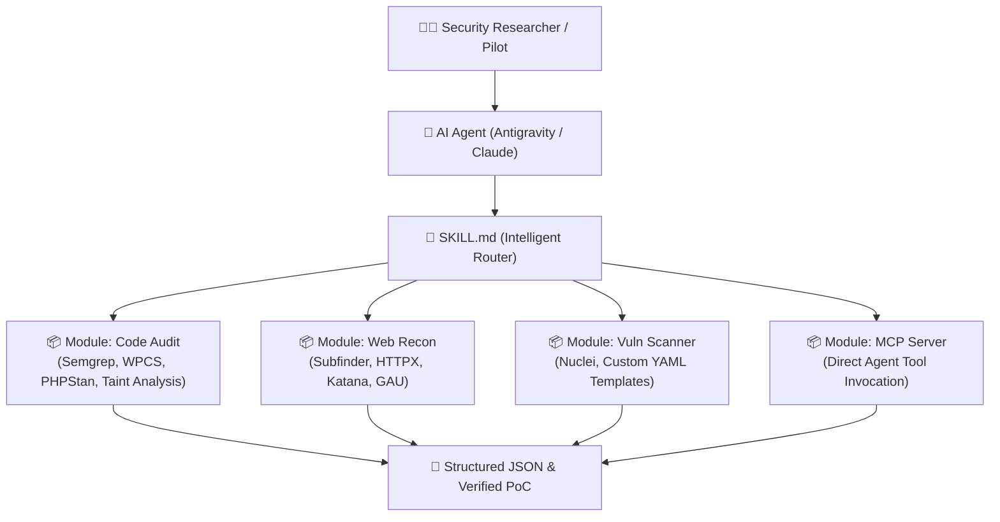

# 🛡️ Agentic Security Arsenal

[](LICENSE)
[](#antigravity--ai-agent-integration)
[](#architecture)
[](#modules)

> **Modular AI Agent Skills & Security Arsenal for Bug Bounty, White-box Code Auditing, and Attack Surface Reconnaissance.**

---

## ⚡ Overview

**Agentic Security Arsenal** is a modern, lightweight, and modular security skill engineered for AI agents (Antigravity, Claude Code, Cursor, and custom LLM copilots). 

Traditional security tools flood LLM context windows with thousands of lines of terminal noise, degrading reasoning quality. **Agentic Security Arsenal** solves this with a **progressive lazy-loading router**: the agent only loads the specific instructions, structured JSON recipes, and SAST rules required for the current target type.

---

## 🏗️ Architecture



---

## 📂 Modules & Capabilities

| Module | Primary Tools | Focus & Capabilities | Target Scenarios |
| :--- | :--- | :--- | :--- |
| **`modules/code_audit`** | `semgrep`, `phpcs`, `WPCS` | Static analysis (SAST), unauthenticated REST API routing, missing nonces, authorization bypass, raw SQL injection. | WordPress plugins/themes, PHP applications, white-box repos. |
| **`modules/web_recon`** | `subfinder`, `httpx`, `katana`, `gau` | Passive DNS enumeration, live web probing, status code discovery, historical URL mining, JS endpoint parsing. | External bug bounty scopes, broad domain assets. |
| **`modules/vuln_scanner`** | `nuclei` | Low-noise YAML template scanning, exposed panels, leaked sensitive documents, CVE verification. | Target validation, reproducing vulnerabilities. |
| **`modules/mcp`** | `pd-tools-mcp` | Model Context Protocol integrations for direct tool calling by AI agents. | Zero-shell autonomous agent executions. |

---

## 🚀 Quick Start

### 1. Clone the Arsenal
```bash
git clone https://github.com/dalroot/agentic-security-arsenal.git
cd agentic-security-arsenal
```

### 2. Antigravity & AI Agent Integration
To install this arsenal as an active skill in your Antigravity agent:
```bash
# Copy or symlink to your Antigravity global skills directory:
mkdir -p ~/.gemini/antigravity/skills/
cp -r . ~/.gemini/antigravity/skills/agentic-security-arsenal
```
Once installed, your agent will recognize the skill whenever you ask:
> *"Run agentic-security-arsenal to audit this WordPress plugin."*  
> *"Use the web_recon module to find live subdomains for target.com."*

---

## 🛠️ Common Recipes

### White-Box Code Audit (WordPress & PHP)
Run Semgrep with our tailored WordPress security rules:
```bash
semgrep --config modules/code_audit/rules/semgrep_wordpress.yml /path/to/plugin --json -o audit_results.json
```

### External Recon Pipeline (JSON Chaining)
Passively enumerate subdomains and identify alive web services with metadata:
```bash
subfinder -d target.com -silent | httpx -silent -json -title -tech-detect -o live_hosts.json
```

---

## 📜 Principles & Safety

1. **Deterministic Structured Data:** All agent recipes prioritize `-json` or `-je` flags, eliminating parsing errors.
2. **Safe Harbor & Scope Respect:** Designed strictly for authorized security assessments, bug bounty programs, and defensive code audits.
3. **Zero Context Bloat:** Never load the whole arsenal at once; load only the module relevant to your active target.

---

## 📄 License
This project is open-source under the [MIT License](LICENSE).
