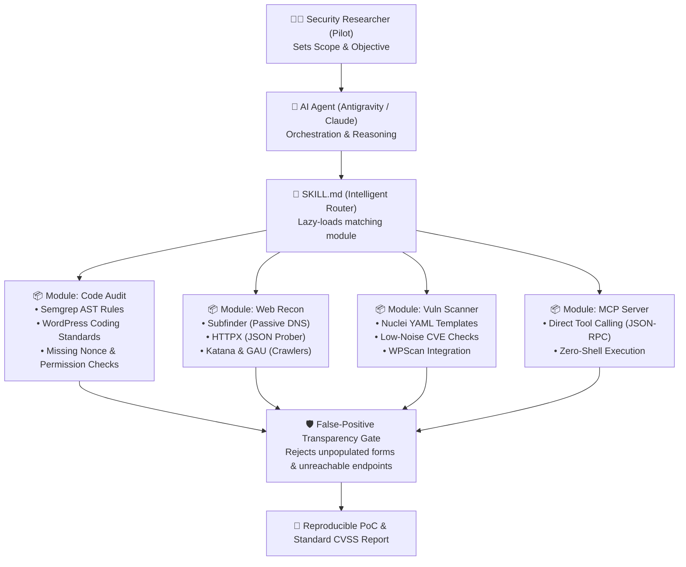

# 🛡️ Agentic Security Arsenal

<div align="center">

[](LICENSE)
[](https://github.com/dalroot/agentic-security-arsenal/stargazers)
[](#-agent-integration)
[](#-architecture--design-philosophy)
[](#-modules--capabilities)

**Modular AI Agent Skills & Security Arsenal for Bug Bounty Hunters, White-Box Code Auditors, and Red Teams.**

*Accelerated by the world's leading open-source security projects, engineered for modern LLMs.*

[Key Features](#-key-features) • [Architecture](#-architecture--design-philosophy) • [Modules](#-modules--capabilities) • [Agent Policy](#-strict-agent-governance-policy) • [Upstream Sources](#-upstream-powerhouses--acknowledgements) • [Quick Start](#-quick-start)

</div>

---

## ⚡ The Problem: Why Traditional Security Tools Fail with AI Agents

When developers connect raw security scanners to AI agents (Antigravity, Claude Code, Cursor, Copilot), workflows break down:
1. **Context Window Flooding:** Raw terminal outputs with thousands of ANSI characters and noise consume 80%+ of the LLM context, leading to forgotten system rules and sluggish responses.
2. **Hallucinated Exploits:** Agents mistake blank template forms, 403 Forbidden origins, and non-exploitable headers for "Critical Remote Code Execution".
3. **Bloated Environments:** Attempting to clone dozens of heavy pentesting repositories degrades workspace agility and storage.

**Agentic Security Arsenal** solves this with a **Zero-Clone, Progressive Lazy-Loading Router**:
- The agent only loads the lightweight metadata for the active target type.
- All command pipelines enforce deterministic, structured JSON output.
- Enforces an unbendable **False-Positive Transparency Gate**.

---

## 🏗️ Architecture & Design Philosophy



---

## ⚖️ Traditional Automation vs. Agentic Security Arsenal

| Feature | Legacy Pentest Scripts | Agentic Security Arsenal |
| :--- | :--- | :--- |
| **Context Footprint** | Dumps raw terminal walls of text into LLM | Progressive lazy-loading; minimal token usage |
| **Output Format** | Unstructured plain text / ANSI colors | Clean, structured JSON (`-json`, `-je`) |
| **Storage Impact** | Clones gigabytes of tool repos locally | **Zero-Clone:** Uses prebuilt binaries & remote registries |
| **Triage Integrity** | Flags everything as high without context | **False-Positive Gate:** Explicitly flags non-exploitable items |
| **Target Flexibility** | Web only or Network only | **Hybrid:** White-Box (WordPress/PHP) + Black-Box (Recon/CVE) |

---

## 📂 Modules & Capabilities

### 1. 🔍 White-Box Code Audit (`modules/code_audit`)
Designed specifically for auditing modern PHP applications, WordPress plugins, and theme codebases.
* **Semgrep Semantic Rules:** Tailored patterns in `rules/semgrep_wordpress.yml` catching unauthenticated REST routes (`permission_callback => __return_true`), raw SQL calls without `$wpdb->prepare`, and unsafe `unserialize()`.
* **Access Control Verification:** Detects missing capability checks (`current_user_can`) even when CSRF nonces are present.
* **AJAX Handlers:** Flags unprotected `wp_ajax_nopriv_` callbacks exposing sensitive operations.

### 2. 🌐 External Attack Surface Recon (`modules/web_recon`)
Silent, high-speed discovery pipelines that keep researchers inside Safe Harbor boundaries.
* **Passive DNS Discovery:** Leverages `subfinder` with 30+ passive sources without sending a single packet to the target.
* **HTTP Probing & Fingerprinting:** Streams `httpx` JSON lines containing response codes, technology stacks, TLS ciphers, and page titles.
* **Historical URL Mining:** Chains `gau` with regex filters to unearth forgotten backups (`.sql`, `.conf`, `.env`, `.bak`).

### 3. 🎯 Targeted Vulnerability Scanning (`modules/vuln_scanner`)
Precision probing without triggering WAF blocks or generating scanner spam.
* **Nuclei Template Engine:** Runs verified community templates matching target technologies with controlled rate-limits (`-rate-limit 30`).
* **Misconfiguration Hunting:** Detects exposed `.git` directories, configuration panels, and sensitive CUI/PII document snippets.

### 4. 🔌 Model Context Protocol (`modules/mcp`)
Native integration for modern AI agents supporting the Anthropic Model Context Protocol (MCP).
* Exposes tools as structured function calls (`pd-tools-mcp`), bypassing shell escaping issues entirely.

---

## 🛑 Strict Agent Governance Policy

Every AI agent running this skill is bound by 4 inviolable rules defined in `SKILL.md`:

1. **Strict Severity Tiering (CVSS v3.1 / Bugcrowd VRT):**  
   No score inflation. High and Critical ratings require actual impact (e.g. state change, data exfiltration).
2. **The False-Positive Transparency Gate (Mandatory):**  
   If a tool flags a finding, but network verification shows it is a blank intake template or unreachable behind a firewall, the agent **MUST EXPLICITLY DECLARE**:
   > ⚠️ **Status: False Positive / Non-Exploitable**  
   > **Technical Reason:** Endpoint times out at origin; cached search engine snippet only.
3. **Zero-Clone Architecture:**  
   Never clone massive remote repositories onto the workspace. Pull rulesets dynamically.
4. **Reproducible Proof-of-Concept (PoC):**  
   Every verified finding must be accompanied by a reproducible cURL command, raw HTTP request/response, or exact source code file and line numbers.

---

## 🌟 Upstream Powerhouses & Acknowledgements

**Agentic Security Arsenal** does not reinvent the wheel. It stands on the shoulders of giants by orchestrating, adapting, and structuring the best open-source security tools in existence. We gratefully acknowledge:

| Project | Repository & Creator | Role in this Arsenal |
| :--- | :--- | :--- |
| **Nuclei** | [`projectdiscovery/nuclei`](https://github.com/projectdiscovery/nuclei) | Gold-standard fast, template-driven vulnerability scanner. |
| **HTTPX** | [`projectdiscovery/httpx`](https://github.com/projectdiscovery/httpx) | Multi-purpose HTTP probe with native JSON streaming. |
| **Subfinder** | [`projectdiscovery/subfinder`](https://github.com/projectdiscovery/subfinder) | High-speed passive subdomain discovery engine. |
| **Katana** | [`projectdiscovery/katana`](https://github.com/projectdiscovery/katana) | Modern headless web crawler and JavaScript parser. |
| **Semgrep** | [`semgrep/semgrep`](https://github.com/semgrep/semgrep) | Lightweight, semantic static analysis engine for code auditing. |
| **WordPress Coding Standards** | [`WordPress/WordPress-Coding-Standards`](https://github.com/WordPress/WordPress-Coding-Standards) | Official security sniffs and nonce rules for WordPress. |
| **PHP_CodeSniffer** | [`PHPCSStandards/PHP_CodeSniffer`](https://github.com/PHPCSStandards/PHP_CodeSniffer) | Essential PHP tokenizing and AST inspection engine. |
| **GAU (GetAllURLs)** | [`lc/gau`](https://github.com/lc/gau) | Ultra-fast archive mining from Wayback Machine and AlienVault. |
| **WPScan** | [`wpscanteam/wpscan`](https://github.com/wpscanteam/wpscan) | Trusted WordPress vulnerability database scanner. |
| **PD Tools MCP** | [`intelligent-ears/pd-tools-mcp`](https://github.com/intelligent-ears/pd-tools-mcp) | MCP server bridging ProjectDiscovery CLI tools to AI agents. |
| **Agentic Bug Hunter** | [`Awarexone/Agentic-Bug-Hunter`](https://github.com/Awarexone/Agentic-Bug-Hunter) | Pioneer agentic bug bounty workflow and prompt designs. |
| **PentestGPT** | [`GreyDGL/PentestGPT`](https://github.com/GreyDGL/PentestGPT) | Foundational academic research on LLM pentesting chains. |

---

## 🚀 Quick Start

### 1. Installation
```bash
git clone https://github.com/dalroot/agentic-security-arsenal.git
cd agentic-security-arsenal
```

### 2. Agent Integration

#### In Antigravity:
Symlink or copy the repository to your global or workspace skills directory:
```bash
mkdir -p ~/.gemini/antigravity/skills/
cp -r . ~/.gemini/antigravity/skills/agentic-security-arsenal
```

#### In Claude Code / Cursor / Custom Agents:
Point your agent to read `SKILL.md` as a system context rule:
```bash
claude --prompt "Read SKILL.md from agentic-security-arsenal and help me audit this plugin"
```

---

## 💻 Sample Agent Workflows

<details>
<summary><b>▶ Example 1: White-Box WordPress Code Audit</b></summary>

```bash
# Agent runs Semgrep against target plugin
semgrep --config modules/code_audit/rules/semgrep_wordpress.yml ./wp-content/plugins/sample-plugin/ --json

# Output parsed by Agent:
# [!] Finding: Unauthenticated REST route in class-api.php:48
# [!] Line: 'permission_callback' => '__return_true'
# [!] Agent Verification: Checks if callback performs state changes without secondary token.
```
</details>

<details>
<summary><b>▶ Example 2: External Attack Surface Recon (Silent)</b></summary>

```bash
# Agent chains passive DNS with JSON probing
subfinder -d target.mil -silent | httpx -silent -json -title -tech-detect -status-code -o live.json

# Agent reads live.json:
# Automatically filters 404/500 noise and groups alive endpoints by tech stack (Apache, Nginx, WordPress).
```
</details>

---

## 🤝 Contributing
Contributions are welcome! If you have optimized Semgrep rules, low-noise Nuclei templates, or new MCP server wrappers:
1. Fork the Project.
2. Create your Feature Branch (`git checkout -b feature/NewRule`).
3. Commit your Changes (`git commit -m 'feat: add rule for PHP object injection'`).
4. Push to the Branch (`git push origin feature/NewRule`).
5. Open a Pull Request.

---

## 📄 License
Distributed under the **MIT License**. See [`LICENSE`](LICENSE) for more details.
