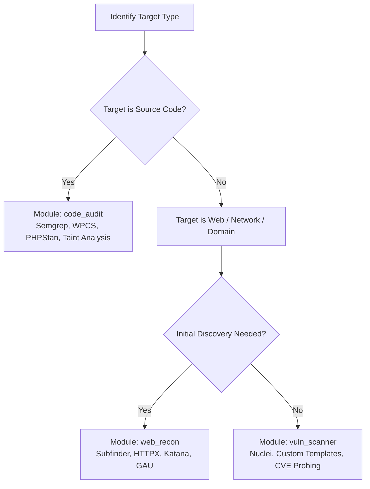

# Agentic Security Arsenal (Skill Guide)

This skill provides an intelligent, modular routing and execution engine for security engineering, bug bounty hunting, and code auditing tasks. It prevents context bloat by acting as a progressive dispatcher: directing the agent to the optimal lightweight tools, recipes, or SAST rules based on target characteristics.

---

## 1. Target Assessment & Dispatch Logic

When handling a security target, evaluate the target type and dispatch the matching module:

### Module Routing Matrix
- **WordPress / PHP Plugins & Themes:**  
  -> Use `modules/code_audit/`  
  -> Primary Tools: `semgrep` with WordPress rules, `phpcs` with `WordPress-Coding-Standards`.  
  -> Key Areas: Unauthenticated REST routes (`permission_callback => __return_true`), missing nonce verification (`wp_verify_nonce`, `check_admin_referer`), missing capability checks (`current_user_can`), and raw database calls (`$wpdb->query`).
- **External Web Assets & Domain Enums:**  
  -> Use `modules/web_recon/`  
  -> Primary Tools: `subfinder` (passive DNS), `httpx` (JSON probing & tech detection), `katana` (crawler).
- **Vulnerability Probing & Misconfigurations:**  
  -> Use `modules/vuln_scanner/`  
  -> Primary Tools: `nuclei` with JSON exports (`-je`), targeted cURL PoCs.
- **Direct Agent Tool Calling (MCP):**  
  -> Use `modules/mcp/` when client supports Model Context Protocol server invocation.

---

## 2. Core Execution Principles & Agent Reporting Policy

To guarantee elite, professional, and hype-free deliverables, every agent invoking this skill MUST adhere to the following 4 inviolable rules:

### Rule 1: Strict Severity Tiering (No Inflation)
Categorize findings strictly using CVSS v3.1 and Bugcrowd VRT:
- **Critical (9.0 - 10.0):** Unauthenticated RCE, Full Account Takeover, SQLi on core auth.
- **High (7.0 - 8.9):** Authenticated RCE, Sensitive Data Exposure (PII/Tokens), High-impact IDOR.
- **Medium (4.0 - 6.9):** Stored XSS, CSRF on state changes, Information Disclosure of internal structure/CUI snippets.
- **Low (0.1 - 3.9):** Reflected XSS with user interaction, open redirects, missing security headers with weak exploitability.
- **Informational / None (0.0):** Best-practice advice, public asset indexing.

### Rule 2: The False-Positive Transparency Gate (Mandatory)
If a tool output or finding is ambiguous, unreachable, or mitigated by an underlying control:
- **DO NOT** claim it as an exploit.
- **MUST EXPLICITLY DECLARE:**
  > ⚠️ **Status: False Positive / Non-Exploitable**  
  > **Technical Reason:** [Explain exactly why: e.g. "Endpoint returns 403 at origin", "Form is an unpopulated blank template", "Nonce check prevents unauthorized state modification"].

### Rule 3: Zero-Clone Architecture
- Do NOT clone heavy third-party git repositories.
- Use pre-built single-binary packages (`subfinder`, `httpx`, `nuclei`, `semgrep`).
- Reference remote rulesets on-demand (`--config p/php`, `nuclei -update-templates`).

### Rule 4: Structured Output & PoC Requirement
- Never report without a reproducible cURL command, raw HTTP request/response, or exact file/line source code reference.
- Prefer `-json` / `-je` flags for programmatic parsing.

---

## 3. Directory Layout

- `modules/code_audit/`: SAST recipes, Semgrep rules for WordPress/PHP, AST analysis guidelines.
- `modules/web_recon/`: Subdomain enumeration, live probing, and crawler pipelines.
- `modules/vuln_scanner/`: Nuclei execution templates and verification checks.
- `modules/mcp/`: Configuration templates for running security tools via Model Context Protocol.
