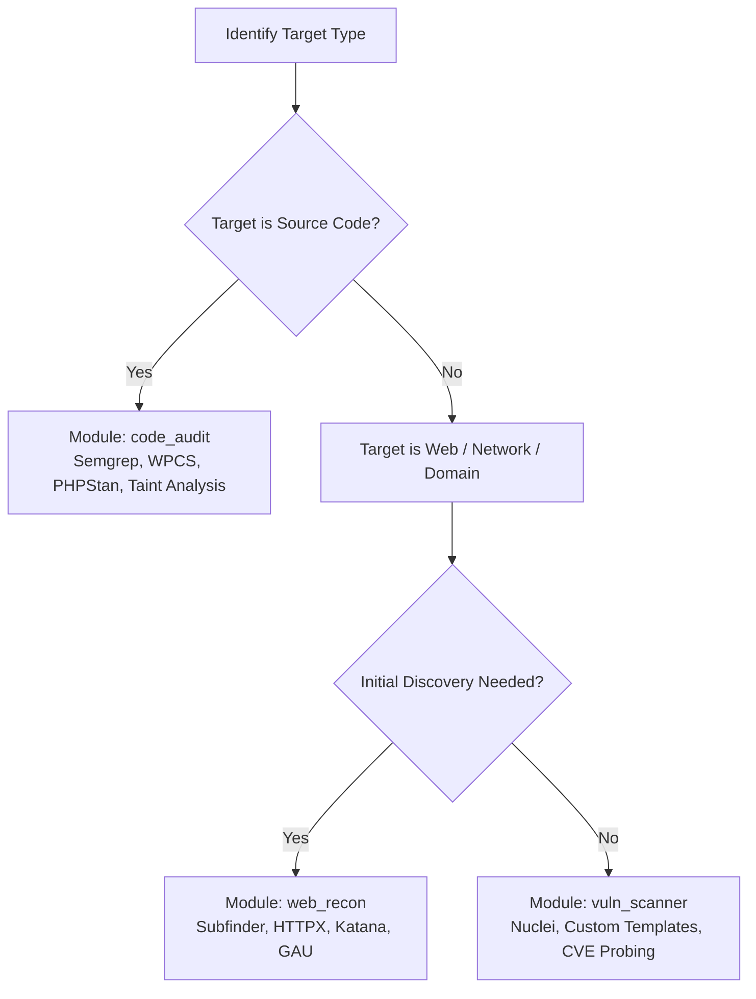

# Agentic Security Arsenal (Skill Guide)

This skill provides an intelligent, modular routing and execution engine for security engineering, bug bounty hunting, and code auditing tasks. It prevents context bloat by acting as a progressive dispatcher: directing the agent to the optimal lightweight tools, recipes, or SAST rules based on target characteristics.

---

## 1. Target Assessment & Dispatch Logic

When handling a security target, evaluate the target type and dispatch the matching module:

### Module Routing Matrix
- **WordPress / PHP Plugins & Themes:**  
  -> Use `modules/code_audit/`  
  -> Primary Tools: `semgrep` with WordPress rules, `phpcs` with `WordPress-Coding-Standards`.  
  -> Key Areas: Unauthenticated REST routes (`permission_callback => __return_true`), missing nonce verification (`wp_verify_nonce`, `check_admin_referer`), missing capability checks (`current_user_can`), and raw database calls (`$wpdb->query`).
- **External Web Assets & Domain Enums:**  
  -> Use `modules/web_recon/`  
  -> Primary Tools: `subfinder` (passive DNS), `httpx` (JSON probing & tech detection), `katana` (crawler).
- **Vulnerability Probing & Misconfigurations:**  
  -> Use `modules/vuln_scanner/`  
  -> Primary Tools: `nuclei` with JSON exports (`-je`), targeted cURL PoCs.
- **Direct Agent Tool Calling (MCP):**  
  -> Use `modules/mcp/` when client supports Model Context Protocol server invocation.

---

## 2. Core Execution Principles for Agents

1. **Structured Outputs First:** Always prefer tools and CLI flags that output structured JSON (e.g. `httpx -json`, `nuclei -je`, `semgrep --json`). This allows deterministic parsing and zero false-positive hallucination.
2. **Safe Probing & Rate Limiting:** Never flood targets with blind brute-force. Respect platform scope rules, rate limits, and safe harbor boundaries.
3. **No Unsubstantiated Claims:** Distinguish strictly between a raw template/blank form and populated data, or between direct origin access and cached search snippets. Always confirm the actual network boundary.
4. **Reproducible PoCs:** Every finding must be backed by a clear, reproducible proof-of-concept (cURL command, HTTP request/response, or source code file and line reference).

---

## 3. Directory Layout

- `modules/code_audit/`: SAST recipes, Semgrep rules for WordPress/PHP, AST analysis guidelines.
- `modules/web_recon/`: Subdomain enumeration, live probing, and crawler pipelines.
- `modules/vuln_scanner/`: Nuclei execution templates and verification checks.
- `modules/mcp/`: Configuration templates for running security tools via Model Context Protocol.
